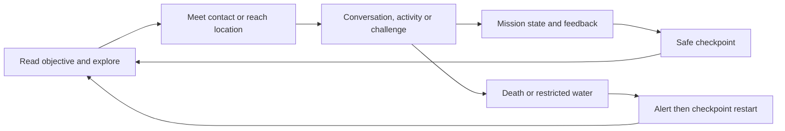

# ALCATRAZ — Game Design Document

**Design revision 1 · 16 October 2026 · source baseline `f97d1e8`**

This is the working design for a single-player third-person prison adventure. It documents current source behavior and defines the remaining work. It is not a claim that all features have been built or tested. Detailed contracts live in [Systems](Systems.md), narrative in [World and Missions](WorldAndMissions.md), and release gates in [Production and QA](ProductionAndQA.md).

## 1. Game concept

**Pitch:** Elias Vale must survive a fictional active Alcatraz, earn the trust of its inmates and turn knowledge of the prison into a route to freedom after learning that his father has been kidnapped.

The player sees Elias move through cells, galleries, yards and the coastline. Conversations create allies and expose opportunities. Short physical challenges, a concealed knife, gang obligations, a phone and isolation bring the story to an escape agreement. Exploration includes boxing, poker, a boat and a helicopter, with firearm equipment available in its separate sandbox mode.

The current chapter ends at that agreement. A complete escape sequence is designed below as a proposed follow-up, rather than advertised as existing gameplay.

| Product decision | Design |
| --- | --- |
| Working title | ALCATRAZ / Alcatraz Escape; “The Silent Blueprint” is a chapter/menu motif. |
| Genre | Third-person narrative action adventure with a compact exploration sandbox. |
| Initial platform | Windows x64 desktop, keyboard/mouse and controller. |
| User-selected hardware target | High-end PC at 2560×1440 and 3840×2160. Final hardware requirements need benchmarks. |
| Engine | Unity 6000.0.62f1, URP 17.0.4; keep the existing project architecture. |
| Audience | Players who enjoy character-led crime stories, grounded traversal and readable mission consequences. |
| Presentation reference | Deliberate body motion and readable third-person framing inspired by the user's Rockstar references. This does not establish animation parity or authorize copying commercial assets. |
| Business model | Proposed premium single-player release. The user's roughly $20 comparison is a quality reference; price and launch date remain undecided. |
| Languages | Current English text/voice; Arabic story notes exist. Additional localization is proposed. |
| Content | Fictional incarceration, gangs, violence and family threats; formal age classification has not been obtained. |
| Connectivity | Core game should work offline after installation. Online multiplayer, accounts and live-service systems are outside the initial scope. |

## 2. Player experience and pillars

1. **A visible, controllable prisoner.** Elias must remain correctly scaled, grounded and readable in ordinary gameplay. Camera collision must not silently turn open-space movement into an eye-level view. Fixing this is the first production gate.
2. **A prison the player can learn.** Cells, work areas, patrol routes and social contacts teach the player where to go. Objectives and signs reinforce geography without filling the screen with text.
3. **Physical actions with clear feedback.** Starts, turns, stops, jumps, hits and landings have understandable timing, sound and recovery. Animation follows actual controller travel.
4. **Trust creates opportunity.** Mission flags, respect and acquired items affect the next objective. An item shown in inventory must correspond to a real state.
5. **A coherent place.** Light, materials, character scale, UI and audio share one direction despite mixed asset sources. A larger download is not an art target.

## 3. Core loops

The primary loop lasts from a conversation to an objective completion: observe the current goal, find the person or place, interact or overcome the challenge, receive feedback, then preserve progress at a safe checkpoint. The chapter loop builds relationships, creates risk, imposes consequences and reveals the next motivation.

The exploration loop allows equipment practice, boxing, poker and vehicles between destinations. It is distinct from mission progression: completing sandbox activities must not silently award story flags or unlock Chapter 01 equipment.

## 4. Mode and content boundaries

| Mode | Existing source scope | Intended player promise |
| --- | --- | --- |
| Supplied island exploration | Scanned exterior, connected authored cellhouse/annex, equipment, NPC damage, activities and vehicles. | Explore and practice without implying a finished campaign. |
| Original island exploration | Earlier authored Alcatraz adaptation with its own geometry and actors. | A separately testable legacy exploration map. |
| Chapter 01 | Mission-driven story with scripted brawl, inventory flags and progression. | Complete the arrival-to-escape-agreement arc. |
| Proposed escape chapter | No implemented campaign continuation established by this audit. | Learn and execute one understandable escape route in a later content milestone. |

Three scenes are enabled in [build settings](../../ProjectSettings/EditorBuildSettings.asset). Cellhouse and annex travel in supplied exploration currently uses in-scene transitions, not separate campaign levels. The authored map and scanned map must keep separate collision, water, minimap and save assumptions.

## 5. Moment-to-moment gameplay

Traversal includes walking, jogging, sprinting, crouching, jumping, surface swimming and short low-bank exits. The third-person camera supports orbit, shoulder/aim framing and obstruction recovery. Sitting belongs to poker and vehicle activities; there is no established universal sit-anywhere system.

Exploration combat supports unarmed attacks, knives and firearms, with ammunition, reloads, blocked muzzle checks and NPC health. Chapter 01 instead uses its scripted rival fight and a quest-controlled concealed knife. General police pursuit and a city-style wanted-star system are not current systems.

Water restriction follows the user's choice: an offshore warning, **WANTED**, then mission/checkpoint restart. Death starts at 0% health, shows **DEAD**, and restarts at full health. Neither response should remove the player's last usable checkpoint.

Conversations and interactions should have one visible prompt, correct actor focus and a safe exit. A mission incident can interrupt activities; cancellation must restore control, camera, actor pose and input ownership.

## 6. Progression, rewards and economy

The current progression is story-state based. Respect changes at authored milestones; contacts, gang membership, tattoo, phone and knife location are explicit flags. There is no established XP tree, crafting economy, hunger system, general suspicion meter or prison-wide cash market.

Poker uses fictional session chips. It must not imply real-money gambling, persistent wealth or mission respect rewards without an implemented rule. Weapons and ammunition in exploration are sandbox state; they are not evidence of a story weapon-acquisition economy.

Proposed Chapter 02 progression should reuse understandable quest flags: route selected, required items acquired, passage opened, boat reached and escape completed. Prefer one complete route over several unfinished vehicle endings.

## 7. World, story and pacing

The setting is a fictional contemporary active prison inspired by Alcatraz, rather than a historical reconstruction. Elias's initial aim is to survive and find allies. The kidnapping reveal turns survival into a need to escape. The proposed continuation ends once he reaches freedom and confirms the next lead about his father; an on-screen rescue and mainland campaign are outside the initial escape-chapter scope.

Chapter 01's first yard incident waits for three contacts, at least four active minutes in the social stage and proximity to the yard. The original five-to-six-minute opening is a pacing intention, not a guaranteed total playtime. Exploration, dialogue reading and travel extend it. Proposed follow-up mission duration must be measured in playtests before marketing claims are written.

Every major sequence needs a short goal, a visible interaction, a completion condition, a failure/retry rule and a checkpoint policy. The [mission document](WorldAndMissions.md) specifies these for both current and proposed content.

## 8. Interface, accessibility and feedback

Use the supplied cinematic menu reference: dark coastal imagery, cream condensed headings, gold lines and clear selection feedback. Concept artwork is suitable for menus; gameplay screenshots must come from a verified build.

The pause menu has ten real sections: Map, Mission, Inventory, Character, Weapons, Journal, Settings, Save Game, Load Game, Exit to Main Menu. Page values derive from live state. The gameplay HUD prioritizes objective, health percentage, compact ammunition, interaction and map information. Avoid decorative values that imply absent systems.

Current menus and story HUD use a uniformly fitted 1920×1080 canvas; the exploration gameplay HUD uses a 1600×900 reference. Readability on 4K, ultrawide, 4:3 and narrow windows needs testing; current scaling is not proof of full responsive reflow. Proposed accessibility work includes adjustable text size, remapping, hold/toggle choices, reduced camera shake, high-contrast focus, subtitles and separate audio buses. Availability must be checked individually before listing an option as implemented.

## 9. Art and animation direction

Characters should have natural scale, distinct silhouettes and readable clothing: faded orange for Elias, navy for officers, restrained variation for inmates. Use worn stone, concrete, salt-stained metal and layered vegetation with consistent material response. The coastal palette favors blue-gray sea/sky and warm lights, with daylight visibility sufficient for navigation.

High/Ultra preserve current original texture detail where imported; this does not mean every older asset retained its original resolution. Spend texture resolution on visible close surfaces. Solve normal maps, roughness, UVs, lighting and LOD transitions before increasing pixel counts.

Keep the existing controller-driven animation pipeline. Improve gait transitions and contact timing first, then add properly licensed lateral/backward movement, crouch-walk, jump, swimming, climbing and combat sets. Hand grips, held equipment and seated alignment must pass close-camera checks. Static police and supplied display figures must not be described as fully rigged actors.

## 10. Audio direction

Ambient layers establish sea, wind, exterior space and prison interiors. Dialogue remains intelligible over footsteps and music. Successful combat contacts, misses, reloads and empty magazines need distinct timing. Effects follow the camera listener and respect pause and volume settings.

Current Unity audio has source hooks and recorded/prototype effects. Helicopter and boat engine loops are missing, and speaker/radio uploads are static props. Add licensed vehicle loops and tune a reproducible mix before calling audio complete. FMOD remains optional; do not require unavailable banks for the baseline game.

## 11. Technical, performance and size constraints

Maintain the pinned Unity/package versions and native asset preparation paths. One owner controls player movement, one controls the camera, and one scene-owned service applies graphics settings. A title screen, activity, dialogue, vehicle or failure must not compete for control.

1440p and 4K are supported resolution choices in source. [Production and QA](ProductionAndQA.md) sets proposed frame-time and memory goals; no benchmark currently proves them. Keep High/Ultra tuning reversible and preserve source assets.

The requested 10 GB size is a planning envelope, not a requirement to pad content. Actual player size must come from a successful Unity BuildReport. No 10 GB executable build exists in the current evidence. Distribution compression, installed size, source checkout size and VRAM use are separate numbers.

## 12. Delivery scope and decision rules

The first milestone is a reliable visible player and complete Chapter 01 with working input, failure/restart and checkpoints. The next is one polished exploration route with consistent art/audio at the chosen hardware target. The escape chapter follows after those gates pass.

Keep multiplayer, a city-scale world, unrestricted police pursuit, complex simulation schedules, destructible buildings and a mainland rescue campaign outside the initial release plan. These can become later proposals with their own design and cost; they must not delay correcting the core camera and movement defects.

Acceptance belongs to a specific requirement in [Requirements.csv](Requirements.csv). Production owners should be roles until people are assigned: gameplay, narrative, technical art, audio and QA. No budget, purchase, release date or external service is committed by this design.

## 13. Known gaps and decisions to validate

The player was reported invisible even after updating main; source recovery changes exist but the rendered issue is still unverified. Treat it as a release blocker until reproduced and resolved in all enabled scenes. Floor support likewise requires live checks for each actor and tier.

Historical dialogue still says Five-card draw while current poker implements Texas Hold’em. Fix text and regenerated audio together in an implementation task. Keep quest knife rules distinct from exploration weapons.

Three requested uploads remain unavailable for import; their records stay blocked. Missing vehicle audio, static police capability, richer mocap, accessibility, complete campaign continuation and target-PC benchmarks remain explicit production work.

The [research record](Research.md) cites the templates actually read. The user-supplied VSQUAD article and blocked official sites are reference candidates, not sources whose contents were inspected.
