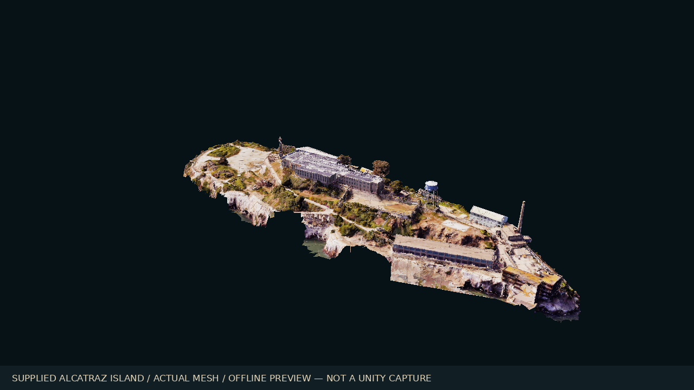
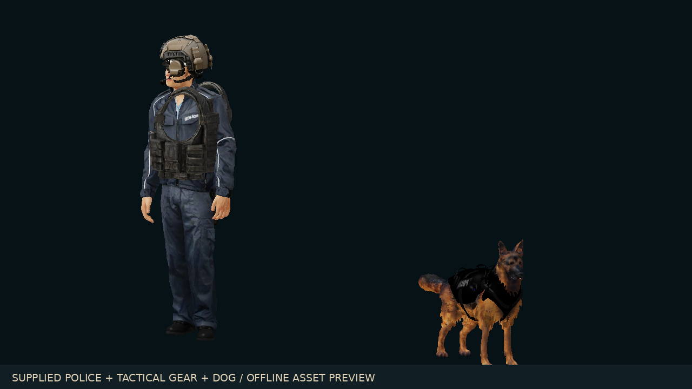
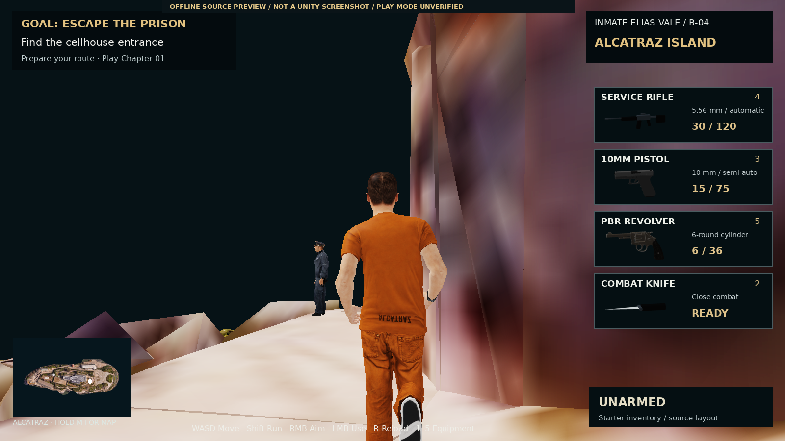

# Alcatraz Escape — Unity source project

**Revision 09 · version 0.9.0 · Unity 6000.0.62f1 · URP**

The playable character is **Elias Vale, a prisoner in orange**. The default exploration scene now uses the **supplied scanned Alcatraz island**, police, animated dog, tactical helmet/vest, Little Bird, coastal house, 10mm pistol and revolver. Chapter 01 retains its playable prison interior, original rigged cast and mission progression.

## Open and play

1. Download the repository ZIP and extract it, or clone this repository. In Unity Hub, choose **Add project from disk** and select the folder containing **Assets**, **Packages** and **ProjectSettings**.
2. Open with **Unity 6000.0.62f1**. Wait for package resolution, model import and automatic asset preparation to finish. The official glTFast package is pinned to **6.14.1**.
3. Choose **Alcatraz > Open Island**, press **Play**, then **Enter**. This opens the supplied island exterior with movement, sound, equipment and the reference-style HUD.
4. Walk to the cellhouse marker and press **E / X**, choose **Play Chapter 01** in the title/pause menu, or choose **Alcatraz > Open Chapter 01** in the editor to enter the playable story interior.

If preparation is incomplete, choose **Alcatraz > Prepare Characters** and **Alcatraz > Prepare Supplied Assets**, then inspect the Console. The editor reconstructs the house's byte-verified FBX and prepares the supplied prefabs before Play/build. First import requires internet access to resolve the declared Unity packages. **Alcatraz > Build Windows x64** includes the supplied exterior, Chapter 01 and the original exploration scene. **Alcatraz > Open Original Playable Island** opens the earlier authored map.

Equipment: **1** unarmed, **2** knife, **3** supplied 10mm pistol, **4** service rifle, **5** supplied revolver. RMB / LT aims, LMB / RT uses, R / Y reloads, and D-pad left cycles. Use the three dock practice targets to check hits. M opens the map. Pause stops reload/cooldown time.

## New in Revision 09

- Free running follows actual travel, with corrected turn handling, start-animation interruption and foot contact. The close-wall camera hides the model when pressed into it and resets after large teleports.
- All nine supplied asset archives are packaged with original archive hashes and native import preparation.
- Coastline crop removes scanned water from render/collision geometry; player, police, dog route, helipad and pier have sampled ground support.
- Equipped stationary police, a dog using the supplied walk/idle/bark clips, parked helicopter and a reachable house dock.
- Usable supplied pistol and revolver, finite ammo/reloads, real source-model thumbnails and live inventory cards.
- Executed weapon-state tests: **468 assertions passed**. Native source and glTF dependency checks passed; CI includes the new supplied-asset checks.

Read [running changes](Documentation/Revision09_RunningFix.md), [asset imports](Documentation/Revision09_SuppliedAssets.md), [island integration](Documentation/Revision09_IslandIntegration.md) and [weapons/HUD](Documentation/Revision09_WeaponsAndHUD.md).

**Unity Editor is unavailable in the authoring environment. Unity import, API compilation, shader rendering, Play Mode and a Windows executable build remain unverified.** The images below are labelled offline source previews, not Unity screenshots.

## New in Revision 08

- User-approved [map and character concept](Documentation/ApprovedConcept/Alcatraz_MapCharacters.png) included as the visual target.
- Original fractured pale shoreline strata and additional coastal scrub, with a new generated ground albedo.
- Connected 2.3 metre coastal service trail, carved terrain, native floor collider, stone parapets and rusty handrails.
- Marine sky, atmospheric daylight, restrained ACES post-processing and depth-aware animated bay water.
- Pale waterfront barracks, blue-gray water tank, facade cornices, downpipes, coping and roof utilities.
- Elias has a dark-haired, lightly stubbled face material and faded orange workwear. Harrow has graying hair and a matte navy uniform. The existing skeletons, facial meshes and animations are retained.
- Source validation workflow, current source previews, and reproducible compressed authoring inventories.

**The approved image is concept art. The included scene is an adaptation using the project's existing character rigs and original environment geometry; it does not exactly reproduce the photorealistic concept.**

See [Revision 08 notes](Documentation/Revision08_ApprovedConcept.md) for the current scope and validation limits.

## Previous Revision 07 additions

- Real openings under all 16 cellhouse skylights; glass no longer casts opaque shadows.
- Dining trays, service grilles, workshop machines, laundry bins, storehouse shelves, shower fittings, a small yard court and dock details.
- A plain orange B-04 outfit for Elias and a blue uniform with badge for Officer Harrow, using edited diffuse textures on the existing rigs.
- Eight additional native NPCs: two guards and six work-detail inmates. There are now 30 actor identities and ten local walking routes.
- Character roster with individual height, build, walking speed and staggered idle phase. Ambient routines check floor support and yield to nearby actors.
- Updated source previews, route checks and opening instructions.

See [Revision 07 notes](Documentation/Revision07_MapCharacters.md) for scope and validation limits.

## Included

| Area | Source implementation |
| --- | --- |
| Alcatraz island | Irregular island mesh, rocky coastline, bay water shader, vegetation and connected roads/paths at multiple elevations. Landmark positions use the NPS map as a reference; dimensions and interiors are adapted for gameplay. |
| Prison | Three tiers; 336 B/C cells; abbreviated A/D rows; 512 regular cell chambers plus seven wider isolation rooms. Furnished cells, stairs, catwalks, bridges, skylight geometry, dining hall, showers and visitation. |
| Landmarks | Recreation yard, lighthouse/keeper, water tower, warden's house, Model/New Industries, power house, storehouse, Building 64, sally port, parade ground and connected dock. Some landmark buildings have simple interiors. |
| Characters | Five MIT-licensed rigged human models with source 2K textures, two edited 1254-pixel uniform atlases, normal maps and URP materials. Orange inmate, separate guard, Black inmates, jacket/hoodie clothing, heavier/leaner variants and 30 actor bindings. |
| Movement/camera | Twelve imported clips, measured walk/run blending, starts/stops/turns, contact IK and pose overlays; shoulder camera, aiming, damping and collision queries. |
| Sound | 44 foundation effects: concrete/metal/wood/grass footsteps, shots, reloads and impacts. Spatial playback, reverb/filtering and the existing 68 English dialogue clips, ambience and score. |
| Equipment | Original prototype knife/pistol/rifle, aiming, finite ammunition, reloads, recoil, muzzle flash, tracers, melee and three targets. General NPC firearm combat/health is not implemented. |
| NPC activities | Ten walking routes, six seated actors and nearby voiced remarks. Poker/conversation tables remain playable in the chapter. |
| Navigation/save | Hold M for the island map, player/objective markers and separate Alcatraz checkpoints. Falling below the bay returns the player to the last grounded position; swimming is not included. |

The project is a source prototype with older rigged character assets. It does not reproduce GTA V/RDR2 production quality. Opsive, paid environment/audio packs and commercial-game assets are not bundled. Unity audio is the default; the existing FMOD bridge requires a separately supplied SDK, events and banks.

## Controls

| Keyboard / mouse | Action |
| --- | --- |
| WASD / mouse | Move / camera |
| Left Alt / Left Shift | Slow walk / run |
| Left Ctrl / Space | Crouch / jump |
| E / Q | Interact / switch shoulder |
| 1 / 2 / 3 / 4 / 5 | Unarmed / knife / 10mm pistol / service rifle / revolver |
| RMB / LMB / R | Aim / use equipment / reload in exploration |
| Hold M / Esc | Island map / pause |

Controller support remains included. See [the chapter guide](README_Chapter01_Revision04.md) for dialogue, phone, poker, retry and checkpoint controls.

## Requested chapter

Mission 1 keeps the timed gang fight and fallen knife, green **Mission completed** or red **Missed** with sound, respect/initiation/tattoo and mandatory knife storage in B-04. Mission 2 rewards a phone and gang contact. Mission 3 includes the rival fight, arrest, 24 hours of isolation represented by 60 seconds sleeping, the guard's knock, Theo's tearful kidnapping reveal and an escape agreement with Malik before next week. The chapter stops at that agreement.

The fight trigger remains four minutes into the opening, designed around the requested 5–6 minute sequence at normal pace. Exploring, reading and travel can extend it. Current dialogue and voices are English; the Arabic story breakdown is at Documentation/Chapter01_Story_AR.md. Alcatraz is a fictional active prison for this contemporary story.

## Build and verification

Install Windows Build Support in Unity Hub, check Play Mode, then choose **Alcatraz > Build Windows x64**. The three enabled scenes build to Builds/Windows/AlcatrazEscape.exe. The batch alternative is Tools/BuildAlcatrazWindows.ps1.

Current offline checks cover native references, static routes, floor support, roster bindings and C# grammar. GitHub Actions repeats source checks; it does not perform a Unity build. Story and poker retain their earlier reports. The ammunition suite was executed again in Revision 09, including the new revolver and live inventory readouts.

**Unity Editor is unavailable here. Real Unity compilation/import, Play Mode, swept physics, live camera/audio/IK, URP output, performance and a Windows build remain unverified. No executable is included.** Follow [the current Play Mode checklist](Validation/Revision09_PlayMode_Checklist.md) before distributing a build.

## Previews, source and credits

- [Alcatraz source previews](Documentation/AlcatrazPreviews/)
- [Implementation/reference credits](Documentation/Revision06_Alcatraz.md)
- [Character preview](Documentation/FoundationPreviews/Characters.png) and [walking source video](Documentation/FoundationPreviews/Walking.mp4)
- [Asset licenses/credits](Documentation/Revision05_AssetCredits.md)
- [Earlier foundation guide](README_Revision05_Foundation.md)

Previews are labelled offline source renders, **not Unity captures or gameplay**. `Documentation/BlackstoneAuthoring.json.gz.part001` through `part003`, and `Documentation/AlcatrazAuthoring.json.gz`, contain the compressed inventories used by the current Python authoring and preview tools. `authoring_io.py` joins archive parts automatically; their original-byte checksum is in `BlackstoneAuthoring.parts.json`. Large Alcatraz render batches are partitioned into normal native Unity meshes with the same triangles, normals and UVs. This keeps individual publication requests small. See `Tools/requirements.txt`. Offline authoring uses Linux with DejaVu fonts; offline previews also require Mesa EGL/OpenGL. Run `python Tools/build_alcatraz.py` to regenerate both Alcatraz scenes, or `python Tools/render_alcatraz_preview.py A01_Island A15_CoastalPath A16_PrisonerPortrait` for labelled source renders. Opening/building in Unity uses the included native assets and does not require Python.

Earlier Blackstone scenes and reports are retained for history. The three enabled scenes and Revision 09 reports describe the current project. Older reports are historical. Rocketbox's MIT notice and existing MakeHuman, Poly Haven, audio and voice credits are included. Scanned surfaces are **Powered by Poly Haven**. Revision 09 also includes the nine user-supplied archives described in `Assets/Game/Supplied/Resources/AlcatrazSupplied/Catalog.json`; their provenance is recorded without claiming authorship or adding a new license.
